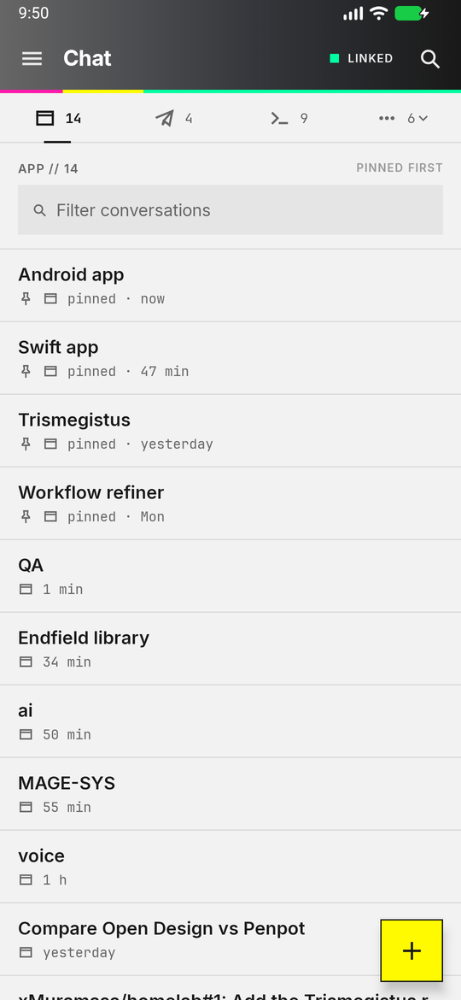
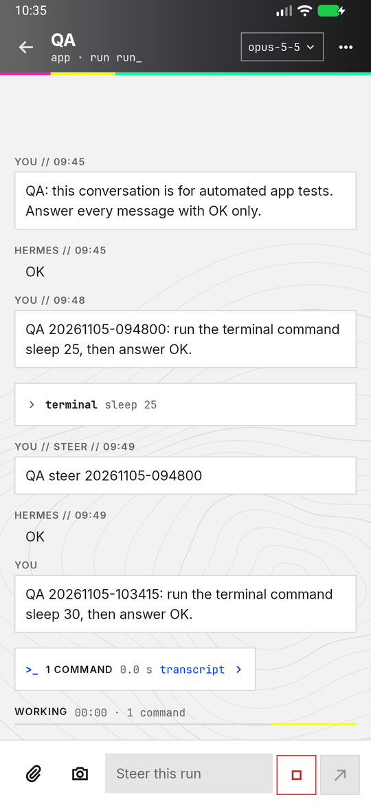
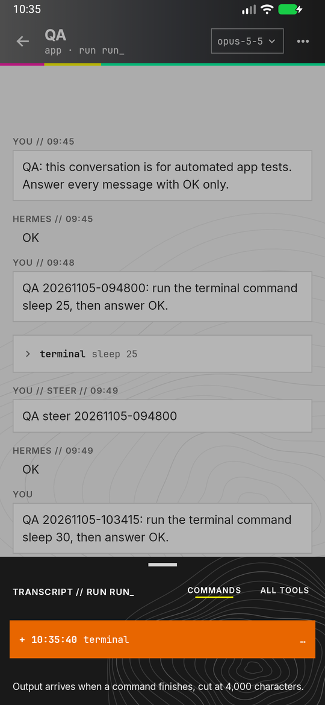
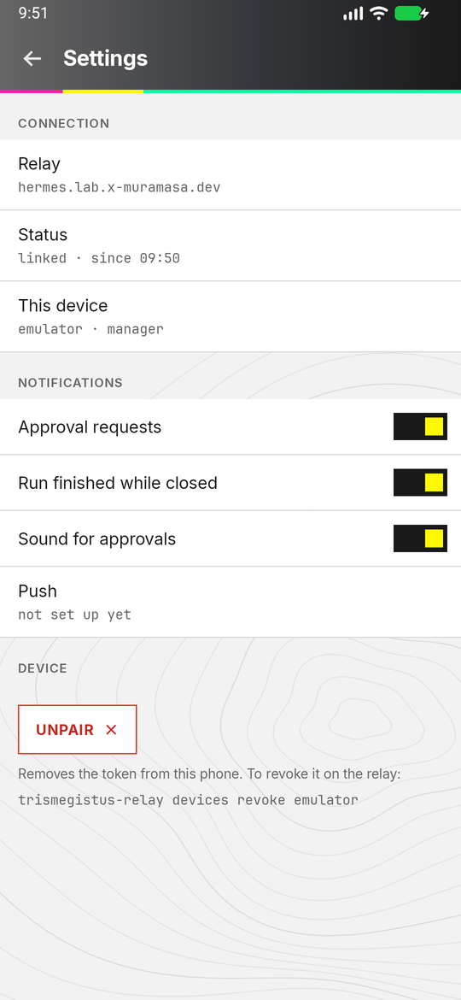

# trismegistus-android

[](https://github.com/xMuramasa/trismegistus-android/actions/workflows/ci.yml)


[](LICENSE)

A native Android companion for [Hermes Agent](https://hermes-agent.nousresearch.com): chat with Hermes on the home
server, follow its tool calls live and answer approval requests, from the phone. It talks to the relay in
[hermes-relay](https://github.com/xMuramasa/hermes-relay), the same way the macOS app
([trismegistus-mac](https://github.com/xMuramasa/trismegistus-mac)) does, and its usability follows that app. Kotlin
and Jetpack Compose. What it does and why: [SPEC.md](SPEC.md).

<p align="center">
  
  
  
  
</p>
<p align="center"><sub>Screens from the automated QA run on a headless emulator (0.1.x, 2026-11-05), in a conversation kept for app tests.</sub></p>

## Highlights

- **Pairing without typing secrets.** Scan the relay's QR code (the camera is asked for only then) or paste the code.
  The device token is sealed with an Android Keystore AES-GCM key and never backed up.
- **Live runs.** Tool progress as it happens, steer or stop a running turn, and a transcript of every command a run
  executed.
- **Approvals.** Once, This session or Deny, right in the conversation.
- **Images.** Up to four per message from the photo picker, the camera or the share sheet, made upright, resized to
  2048 px and re-encoded without EXIF (no location).
- **Works offline.** The last list and conversations stay readable while the relay is out of reach; the app
  reconnects with backoff and resubscribes from the last event it saw.
- **One design system.** Colours, spacing, type and icons are generated from the same design tokens as the Mac app
  (`scripts/gen-tokens.py`), and `scripts/check-tokens.sh` (run in CI) fails on any raw colour or size outside the
  theme.
- **Tested.** JVM unit tests for the protocol client and the screens' logic, contract tests against the relay's
  protocol examples, lint, and Maestro UI flows on an emulator.

Status: 0.1.2, installed on a Galaxy S21 and checked by the Maestro flows on an emulator. Next: notifications through
ntfy / UnifiedPush and the GitHub, News, Agents, Jobs and Commands sections.

## Build

`scripts/build.sh` runs Gradle in a container (`docker/Dockerfile`: JDK 21 + Android SDK platform 37 and build tools
36.0.0) and by default runs the unit tests, lint and both APKs; pass Gradle tasks to run others
(`scripts/build.sh :core:test`). Nothing is needed on the host but Docker.

State outside the repo, in `~/.local/share/trismegistus-android/`:
- `gradle/`: Gradle's caches (delete to start clean);
- `android/`: the debug keystore;
- `signing/`: the release key (`release.jks`) and `keystore.properties`. **Back it up**: Android only installs an
  update signed with the same key; with a new key the app must be uninstalled first (its pairing and settings go
  with it).

`scripts/publish.sh` builds the signed release and publishes it at `https://dl.lab.x-muramasa.dev/trismegistus.apk`
(tailnet only) plus a copy named by version.

## Protocol

`protocol/` is a copy of the relay repo's `protocol/` (schema and examples). `scripts/sync-protocol.sh` refreshes it
from `~/Projects/hermes-relay/protocol` and writes `protocol/SOURCE` (`scripts/protocol-hash.sh`); a contract test
fails while the copy is stale.

## Design

`design/phone-draft/`: the agreed Penpot draft (#2) and the controls page. `design/tokens.json` and
`design/endfield-palette.json` are copies (trismegistus-mac's tokens and the Endfield palette they reference),
refreshed by `scripts/sync-tokens.sh` (hashes in `design/TOKENS_SOURCE`); `design/android-tokens.json` adds the
phone's type sizes and component sizes; `design/icons.json` holds the draft's 16-unit stroke icons as SVG paths.
Inter and JetBrains Mono are bundled in `app/src/main/res/font/` (SIL OFL, `licenses/`).

## App

First start: pair. On optiplex `trismegistus-relay pair --name s21 --role manager --replace` prints a QR and a code;
the app scans the QR (the camera is asked for only then) or takes the pasted code and the relay URL. The token is
sealed with an Android Keystore AES-GCM key and kept in the app's DataStore; nothing is backed up or transferred.

Then Chat: ☰ (or a swipe from the left) opens the drawer with the relay status, Chat, this device and settings. The
list has the kind tabs (APP, TELEGRAM, TERMINAL, MORE), a filter, long-press for pin, rename, tags and delete, and +
for a new conversation. A conversation shows the approval banner (Once / Session / Deny), the messages, one marker per
run that opens the command transcript, and the composer: SEND, or STEER and Stop during a run; up to four images
from the photo picker, the camera or Android's share sheet, made upright, resized to 2048 px and re-encoded without
EXIF. Read-only sources (Telegram, terminal) have no composer; a viewer device can't attach images.

While the relay can't be reached the app shows the last list and conversations it saved (`files/offline.json`) and
retries with backoff, and at once when it comes to the foreground. Settings: the connection, the notification
switches (used by #5), unpair (removes the token, the cache and the images; revoke on the relay with
`trismegistus-relay devices revoke <name>`).

## Code

- `core/`: protocol, `RelayClient`, `RelayRest`, `SessionStore`, `CommandLog`, `ConversationKind` (Kotlin/JVM, no
  Android).
- `app/src/main/kotlin/dev/xmuramasa/trismegistus/`:
  - `MainActivity`, `AppViewModel` (pairing, the relay session, the back stack in `Nav`, trays, the offline cache);
  - `data/`: `TokenCipher` (Keystore), `Prefs` (DataStore), `RelaySession` (client, REST, store and an image loader
    that sends the token to the relay only), `OfflineCache`, `LogcatLogger`;
  - `chat/`: the pure logic the screens show: `ConversationList`, `ChatTimeline`, `Markdown` (commonmark to
    `AnnotatedString`), `RelativeTime`;
  - `image/`: `ImageSizing` (the maths) and `ImagePrep` (decode, EXIF, JPEG); `pairing/PairingInput`;
  - `ui/`: `theme/` (generated tokens and glyphs, `TrismegistusTheme`, the contour background), `components/`,
    `shell/` (drawer), `chat/`, `pairing/`, `settings/`.
- Tokens: `python3 scripts/gen-tokens.py` turns the four `design/` files into `ui/theme/Tokens.kt` (colours with the
  `{endfield.*}` references resolved, spacing, radius, stroke, opacity, the phone's type roles and sizes, the steel
  gradient) and `ui/theme/Glyphs.kt` (the icons as `ImageVector`s). `scripts/check-tokens.sh` fails when either is
  stale or when a file under `ui/` outside `ui/theme/` writes a raw `Color(0x…)` or a `.dp` / `.sp` literal other than
  0 and 1 (exceptions would go in `scripts/token-allowlist.txt`, one path and a `#` reason per line; none needed yet).
- Tests: `scripts/build.sh :app:test` runs the app's JVM tests (Markdown, image sizes, the generated tokens against
  `design/`, the list and timeline logic, navigation, pairing input, the offline cache).

## QA

Automated UI checks on a headless Android emulator on Martin's Mac, run from optiplex with
[Maestro](https://maestro.mobile.dev) flows (`qa/flows/*.yaml`):

```
scripts/build.sh assembleRelease      # the APK under test
scripts/qa.sh                         # every flow; scripts/qa.sh 02-chat for one
scripts/qa.sh stop                    # shut the emulator down
```

- `qa/mac/emulator.sh` (copied to the Mac) creates and boots `Trismegistus_QA`: an S21 FE-sized phone
  (1080 x 2340, 420 dpi = 411 x 891 dp) on the Android 37 arm64 image Android Studio installed, no window, no
  animations. It stays up between runs.
- The emulator is paired with the relay as device `emulator` (manager), once:
  `docker exec trismegistus-relay trismegistus-relay pair --name emulator --role manager`, code typed into the
  pairing screen. `scripts/qa.sh setup` once creates the `QA` conversation the chat flows write into (each chat
  run costs two short Hermes replies).
- Results: `~/.local/share/trismegistus-android-qa/runs/<stamp>/` (screenshots named after the steps, JUnit
  `report.xml`, `maestro.log`).
- Needs on the Mac: Android Studio (SDK, emulator, the image) and Maestro in `~/.maestro` (Java from Android
  Studio's JBR).
